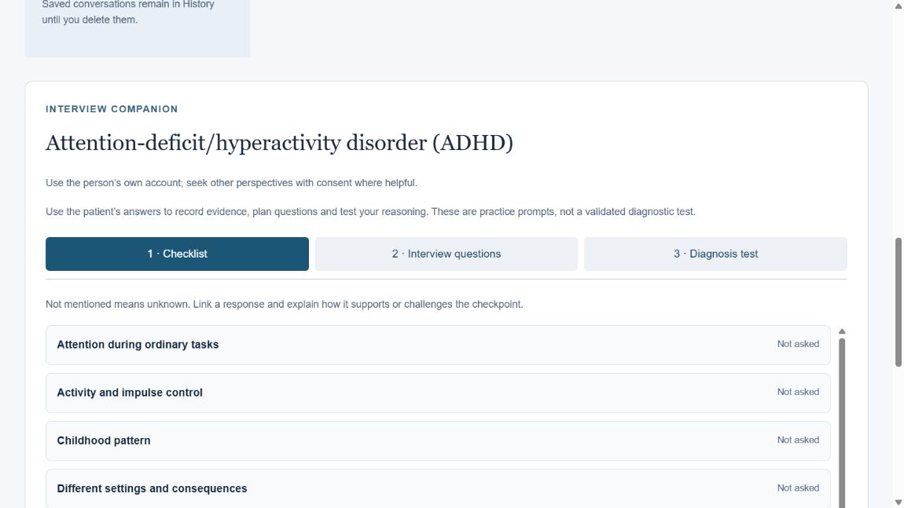
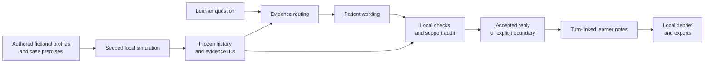

# PsychLab

**Practice the interview. Follow the evidence. Understand the person.**

PsychLab is an experimental AI interview simulator for psychology and healthcare learners. Prepare a fictional person's history, ask questions in your own words, connect observations to what they actually said, and finish with a debrief that makes unanswered questions visible.

The central design choice is simple: **the person's history is created and frozen before the interview begins**. AI can turn that record into a conversation; it cannot write new facts back into the case.

**ForgeHacks 2026 · AI + Healthcare**

[Run it locally](#run-it-locally) · [Judge's walkthrough](docs/JUDGES_GUIDE.md) · [Verified package results](docs/VALIDATION.md) · [Research map](docs/RESEARCH_MAP.md) · [Evidence and limitations](#evidence-and-limitations)

## Why this belongs in healthcare

A patient account contains timing, context, relationships, ordinary preferences, and uncertainty. A learner needs to ask useful questions, distinguish observation from interpretation, and explain what remains unknown before reaching a conclusion.

PsychLab makes those interactions something a learner can rehearse. Its intended beneficiaries are students preparing for supervised interviewing and educators reviewing how a learner gathered and interpreted an account. The healthcare contribution is better opportunities to practice clear questions and evidence-based follow-up; improved clinical or educational outcomes have **not** been established.

This addresses the ForgeHacks AI + Healthcare prompt through healthcare communication and preparation for supervised practice. It does not offer diagnosis, treatment recommendations, risk clearance, or care for real patients.

## What you can do

| Capability | What happens in the application |
|---|---|
| Meet different fictional people | Eight profiles span seven life stages. Younger-child scenarios use caregiver accounts; other cases can use a supported perspective. |
| Choose the practice task | Select a compatible condition, a mystery case with its label withheld during the interview, or no assigned disorder. The catalogue has 68 options, including No disorder. |
| Prepare a stable history | Choose 1–90 recent simulated days and a seed. Preparation runs locally and freezes the resulting record. |
| Adjust the conversation | Beginner, Standard, and Challenging change disclosure and phrasing while preserving the underlying history. |
| Ask natural questions | In live mode, separate model roles select evidence, phrase a reply, and check support and relevance. |
| Follow up across turns | A compact source ledger retrieves earlier topics without turning generated dialogue into new case facts. |
| Make reasoning traceable | Link checklist observations to interview turns; record alternatives, missing information, and next questions. |
| Reflect after finishing | The debrief highlights useful questions, evidence-link gaps, unresolved areas, and possible follow-up prompts. |
| Keep a record | Save disclosed conversations and learner notes in browser History; download the conversation or debrief. |
| See resource use | Live mode displays attempted model calls, reported tokens, and versioned cost estimates, including missing usage. |

The practice guides contain 334 condition-specific checkpoints across 67 guides, plus 17 broad prompts. They are authored educational aids, not reproduced diagnostic manuals or validated instruments.



*Historical interface preview from the October 2026 development materials. This illustrates the practice interface; it is not a new live model evaluation.*

## Run it locally

Use **Node 24.21.0**, pinned in [.node-version](.node-version). The application uses Node built-ins and plain browser modules; it has no third-party npm runtime dependencies.

From the repository root:

```sh
npm run demo
```

Open **http://127.0.0.1:8780** for the historical scripted review. No installation step, API key, model call, or internet connection is needed after obtaining the repository and Node runtime. Stop the server with `Ctrl+C`.

### Choose the right mode

| Mode | Credentials/network | What it demonstrates |
|---|---|---|
| Key-free review (`npm run demo`) | No key or external service | The original fixed-response Alex rehearsal: interview topics, assessment explanation, written reasoning, and an evidence-linked debrief. It does not demonstrate the current live model or all current features. |
| Live AI interview | A Featherless account, an available model ID, a server-side key, and internet access | Free-text evidence routing, patient wording, support auditing, and measured provider usage. Requests may incur charges. |
| Unconfigured live server | No provider key | Case selection and history preparation; AI answers remain unavailable. |

The key-free review is a reproducibility aid. It must not be presented as a live model run. Historical screenshots and saved evaluation replies are also distinct from a new live response.

### Enable live AI

Copy the root `.env.example` to `.env.local`, then fill in `FEATHERLESS_API_KEY` and an exact `FEATHERLESS_MODEL` in a private editor. Start the current application from the repository root:

```sh
npm start
```

Open **http://127.0.0.1:8770** unless you changed `PSYCHLAB_PORT`. Without a provider key, the current app still lets you prepare histories and inspect the setup flow; free-text AI answers remain unavailable.

Keep keys in private local configuration or the documented Windows credential store. Never add them to source, screenshots, browser code, transcripts, or a public repository. The model ID must be available to your own provider account; this repository does not supply credits or credentials.

For Windows setup, runtime verification, and credential storage, see [the application guide](psych-simulator-foundation/live/README.txt). The Windows launcher stores remembered credentials outside the repository using Windows DPAPI.

### Check the software

```sh
npm test
npm run test:security
npm run check:privacy
```

The main suite uses local fixtures and mocked providers; it makes no paid model requests. The security subset checks the relevant browser, HTTP, identity, and provider boundaries. The privacy scan checks the distributable files for excluded configuration and suspicious sensitive content.

**Verified publication-copy result:** `npm test` ran **476 tests: 475 passed, 0 failed, 1 skipped** on Windows with Node 24.21.0. The security subset ran **53 tests: 52 passed, 0 failed, 1 skipped**. Both skips concern the same project-local Windows runtime check; that downloaded runtime is intentionally absent from this distribution. See [the validation record and full log](docs/VALIDATION.md) for startup checks, scope, and exclusions.

Separately, the source project's earlier [security-hardening run](work/psychlab-security-tests-2026-10-10.txt) recorded **471 passing automated checks** with its local runtime installed. These are software checks using local data and mock providers, not live-model benchmarks or clinical studies.

### If something does not start

| Symptom | Check |
|---|---|
| Runtime version is rejected | Run `node --version` and use the version in `.node-version`. The project does not install or change your global runtime automatically. |
| The port is already in use | Stop the server you previously started. For the live app, set a different `PSYCHLAB_PORT` in your private root `.env.local`, then restart. |
| History prepares but questions are unavailable | This is expected without both a provider key and model ID. Use the scripted demo for a complete key-free workflow. |
| A provider request fails | Check access to the configured model and your provider account. Failed attempts can still consume usage; retries are deliberate. |
| A research HTML link displays source on GitHub | Open the file locally in a browser. The corresponding text, JSON, and source registers remain inspectable in the repository. |

The scripted demo and current live application use different ports so they can be inspected separately. They do not share session state.

## A first interview

1. Choose **Jordan**, a short recent-history window, a seed, and **Standard** difficulty.
2. Select a named case for a transparent walkthrough, or **Random** to practice without seeing the target label.
3. Prepare the history. Preparation itself makes no model requests.
4. In live mode, ask an ordinary opening question, then explore interests, changes over time, daily functioning, and relationships. Follow the actual answer rather than assuming a fixed response.
5. Use the Interview companion to link an observation to an answered turn. A reference such as `T2` should support a specific statement.
6. Record an alternative explanation, an uncertainty, and a next question before finishing.
7. Inspect the debrief and download it. Notice that gaps remain visible rather than becoming a diagnosis score.

For a short presentation with explicit offline/live wording, follow [the judge's guide](docs/JUDGES_GUIDE.md).

## How the system works



### Simulate and freeze

The engine combines stable authored personal facts, an educational case premise, and recent events. Interests, relationships, goals, and communication preferences are separate from the chosen clinical presentation. The recent-day window does not age a person from birth.

Local modules represent physiology, memory, appraisal, affect, social action, world consequences, and identity learning. These are executable simulation rules, not separate paid AI agents. Their equations and coefficients are authored engineering assumptions; research motivates the distinctions but does not validate the numerical dynamics.

The frozen evidence has explicit source IDs and time scope. The same seed reproduces history for the same configuration and code. Random case selection is separate from the diary seed, and live wording is not guaranteed to repeat.

### Interview against that record

In live Featherless mode, the ordinary checked answer path uses up to three provider calls:

| Role | Responsibility | Boundary |
|---|---|---|
| **CORTEX** | Select relevant facts and route the question. | Source IDs must belong to the frozen case. |
| **LANGUAGE** | Express permitted evidence as patient or caregiver speech. | A plausible detail is not permission to invent it. |
| **AUDITOR** | Check support, relevance, and inappropriate disclosure. | A model approval is not proof of factual correctness. |

Local guards add checks for specific failure classes, including unsupported names, causes, timing, and extrapolations from usual preferences to current wellbeing. Some social acknowledgments or boundaries use fewer calls. Rejected candidates are not presented as patient answers, but attempted provider calls still count toward usage.

Memory tracks disclosed sources and retrieves canonical evidence for callbacks. Earlier generated wording cannot become a new case fact. Optional context is trimmed before the prompt budget is exceeded; the question and canonical answer evidence are not silently shortened.

### Reflect without pretending to grade competence

The learner records a provisional impression, supporting evidence, alternatives, uncertainties, and next steps. The debrief checks the structure and traceability of that work. It does not establish diagnostic correctness, infer clinical competence, or turn the simulation's hidden label into a verified clinical conclusion.

Case preparation, memory bookkeeping, interview notes, debrief construction, and cost display run locally. They do not each add a model request.

## What is active, and what is experimental

| Component | State in this repository |
|---|---|
| Frozen-history live interview, guides, notes, debrief, history, and cost display | Implemented; live answers require a configured provider. |
| Key-free review | The preserved historical scripted rehearsal, served locally and explicitly labelled as having no live AI. |
| Optional answer-planning path | Staging experiment; disabled by default. |
| Adaption example pack | **Inactive.** A 25-example pilot produced 21 approved examples, but approval of examples is not approval of a runtime release. |
| Verified release selection | Prepared tooling; no approved active release is claimed. |
| Clinical case approval, validated competence scoring, learner-outcome evidence | Not established. |

Adaption is an offline example-improvement workflow. It is not called during interviews, does not retrain the hosted Featherless model, and does not supply new facts about the current patient. Its results and unsuccessful comparisons are retained for inspection.

The staged answer planner can partition a question into supported and missing parts. A conservative repair can replace a draft with exact permitted excerpts. This can reduce naturalness and still does not prove that the right evidence was selected. See [the development status](psych-simulator-foundation/adaption/DEVELOPMENT-STATUS-2026-10-09.txt) before enabling any staging option.

## Evidence and limitations

PsychLab keeps software checks, live-response reviews, research sources, and clinical validation distinct.

| Evidence | What the saved records establish | What they do not establish |
|---|---|---|
| [Prepared repository verification](docs/VALIDATION.md) | 476 full-suite tests: 475 passed, 0 failed, one expected local-runtime skip. Security subset: 52 passed of 53, same skip. | Paid provider behavior, public deployment, or remote CI execution. |
| 471-check source verification run | The recorded automated suite passed after security hardening. | Live accuracy, clinical validity, or the result of a later modified checkout. |
| Historical 16-case v153 regression | 16/16 passed its independent response review for that revision. | Fresh generalization; those cases had informed fixes. |
| Wider v153 comparison | Baseline passed 24/36; candidate passed 23/36. A hard regression kept the candidate from release. | That higher aggregate quality alone justified activation. |
| Earlier conversation evaluation | A documented composite found 34 acceptable responses and two blocked responses. | A single fresh 34/36 run; it combined a full run with targeted follow-ups under different hashes. |
| Personality and interview research | Traceable sources, design choices, and explicit inference gaps. | Empirically fitted simulation equations or validated fictional clinical cases. |

The [research map](docs/RESEARCH_MAP.md) links each collection and explains how to read the evidence. The [v153 development status](psych-simulator-foundation/adaption/DEVELOPMENT-STATUS-2026-10-09.txt) and [combined conversation review](research/interview-improvements-2026-10-08/Combined-evaluation-review.txt) preserve the unsuccessful and incomplete results as well as the improvements.

Important limits remain:

- All cases and patient details are fictional. Authored educational formulations are not clinically approved cases.
- The simulation is experimental. It does not model a complete mind or predict real human behavior.
- Fact IDs and a model auditor can miss unsupported wording, wrong source selection, omissions, and irrelevant answers. Conservative checks can also block useful replies.
- A caregiver account does not establish a child's private experience. Missing information remains unknown.
- English topic and callback behavior has been tested; equivalent performance across languages has not been established.
- The guides do not reproduce the full licensed DSM-5-TR. Assessment references have their own usage, interpretation, age, and language requirements.
- No controlled learner study, patient-outcome study, clinical endorsement, or validated competence score is claimed.

## Security, privacy, and costs

The public application serves a small asset allowlist. Credentials remain on the server; browser session cookies are `HttpOnly` and `SameSite=Strict`, with `Secure` on configured public access. Public access verifies signed identity claims, session ownership, and explicit reviewer permissions. Requests are limited, request bodies are bounded, and same-origin checks protect mutations. The UI renders conversation content as text and restricts external reference links to HTTPS.

The project is an in-memory prototype, with no SQL database, password table, file-upload endpoint, or webhook handler. Database RLS and password hashing are therefore not features it can claim to have enabled. If those systems are added, they need their own controls and review.

Active sessions expire after two hours of inactivity or a server restart. Browser History intentionally stores disclosed conversations and learner notes on that browser profile; it does not store authentication tokens, API keys, hidden case state, or reviewer traces. Use fictional material only. Clear History or browser data to remove those local copies; downloaded files remain on the device.

Default limits are 60 attempted calls per interview and 300 per server run, with up to 80 turns per session. Token-based cost estimates use versioned rates and expose incomplete usage. They are estimates, not invoices or an account spending cap. No automatic paid retries are added.

See [the security checklist](psych-simulator-foundation/live/Security%20review%20and%20checklist.txt) for implemented controls, deployment assumptions, and remaining work. Public hosting is not required for local review, and this repository does not claim that a public endpoint is currently available.

Before publishing changes, read [the privacy and publication guide](docs/PRIVACY_AND_PUBLICATION.md). The [archive notes](docs/ARCHIVE_NOTES.md) explain retained resources, excluded local material, and historical records.

## Repository guide

```text
psych-simulator-foundation/
  live/                 Current server, browser app, case data, and tests
  personality_system/   Research registry, identity rules, contracts, diagnostics
  adaption/             Offline examples, evaluations, reviews, release tooling
  prototype/dist/       Earlier fixed-response rehearsal and shared scoring code
  data/                 Original authored case, sources, rubric, fixtures
  engineering/          Foundation prompts, adapters, and deterministic checks
  review/               Reviewer form, walkthroughs, demo and debrief materials
  design/               Architecture and integration notes
research/               Four dated research and live-evaluation collections
docs/                   Judge's guide and research navigation
work/                   Historical builders, diagnostics, and verification records
```

The historical prototype is intentionally preserved. It uses fixed authored responses and contains reviewer-visible case material; it is a review aid, not a secure examination deployment. Current code also imports its GAD-7 scoring function, so the folder is not merely a screenshot archive.

Older documents describe earlier milestones. For the present baseline, start with this README, [the live application guide](psych-simulator-foundation/live/README.txt), and [the research map](docs/RESEARCH_MAP.md). Archived status reports retain their original context and should not be read as current release guarantees.

### Follow one claim into the source

| Question | Start here |
|---|---|
| What facts define a person before interview? | [Profiles](psych-simulator-foundation/live/patients.mjs), [individuality](psych-simulator-foundation/live/individuality.mjs), and [history engine](psych-simulator-foundation/live/engine.mjs). |
| How is a reply constrained? | [Model roles](psych-simulator-foundation/live/model.mjs), [factual checks](psych-simulator-foundation/live/factual-support.mjs), and [prompt budgets](psych-simulator-foundation/live/prompt-context.mjs). |
| What does feedback actually assess? | [Guide state](psych-simulator-foundation/live/interview-guide.mjs), [debrief logic](psych-simulator-foundation/live/interview-feedback.mjs), and the [unvalidated rubric](psych-simulator-foundation/data/rubric.json). |
| Which research supports a simulation choice? | [Personality literature review](psych-simulator-foundation/personality_system/research/literature_review.md), [evidence map](psych-simulator-foundation/personality_system/evidence/evidence_map.json), and [model contract](psych-simulator-foundation/personality_system/docs/model_contract.md). |
| Why is the optional release inactive? | [Adaption pilot results](psych-simulator-foundation/adaption/RESULTS-2026-10-09.txt) and [later failed comparison](psych-simulator-foundation/adaption/DEVELOPMENT-STATUS-2026-10-09.txt). |

## AI and research disclosure

Codex assisted with development, security hardening, packaging, and documentation. The live application uses Featherless-hosted language models for the roles described above; its local simulation and debrief are code. The separate Adaption pilot generated candidate examples for review. The key-free review does not invoke a live model.

Public research references inform the design, including sources indexed from professional and public-health organizations and a 36-source personality registry. Listing a source or using a service does not imply affiliation, endorsement, or clinical approval. Source counts overlap between collections and must not be added as unique publications.

Third-party materials retain their own rights and terms. References and assessment links are provided for provenance; their inclusion does not grant permission to reproduce a licensed manual or reuse an instrument without checking its requirements. The package is marked `private: true` and `UNLICENSED`; no open-source license has been selected or granted by this README. Read [the license notice](LICENSE-NOTICE.md) and [third-party notices](THIRD_PARTY_NOTICES.md) before reuse or redistribution.

See the [license notice](LICENSE-NOTICE.md), [third-party attribution](THIRD_PARTY_NOTICES.md), and [privacy preparation record](docs/PRIVACY_AND_PUBLICATION.md). Personal configuration and deployment identities have been excluded while the research and fictional data remain available for inspection.

## Next steps

The next useful milestones are qualified review of the authored cases and interview guides, a supervised usability study with learners, and a matched live evaluation that passes every release gate before activating optional examples or planning. Broader language coverage and a deployment-grade data-retention design should follow evidence about the intended users and setting.

PsychLab's current contribution is an inspectable practice workflow: a stable fictional account, questions that matter, and conclusions that stay connected to the evidence obtained.
